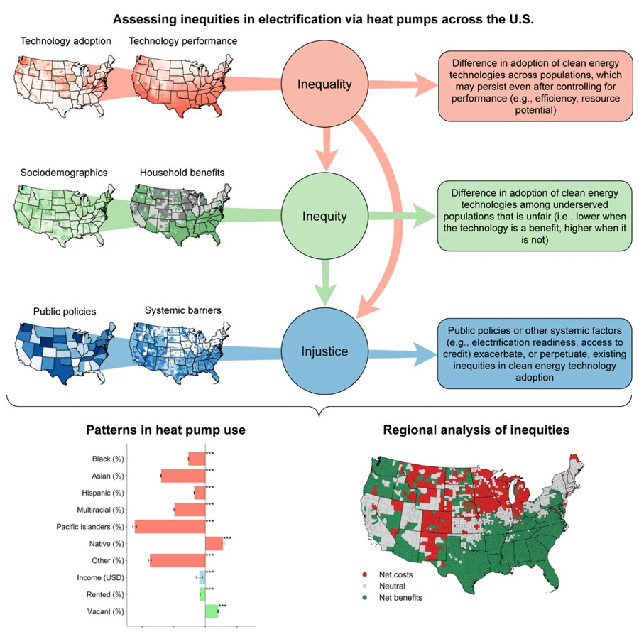

## Published

Graphical abstract, <em>Joule</em> (2024).

<strong>Assessing inequities in electrification via heat pumps across the US</strong>

with Morgan R. Edwards, Jaime Garibay-Rodriguez, Jacob Shimkus Erickson, Muhammad Shayan, Xingchi Shen, Yueming Qiu, and Pengfei Liu

<em>Joule</em>, 2024 &nbsp;|&nbsp; <a href="https://doi.org/10.1016/j.joule.2024.09.012" target="_blank">DOI</a>

Abstract

Heat pumps are an energy-efficient and increasingly cost-effective solution for reducing greenhouse gas emissions in the building sector. However, other clean energy technologies, such as rooftop solar, are less likely to be adopted in underserved communities, and thus policies incentivizing their adoption may funnel support to well-resourced communities. Unlike previously studied technologies, the effects of heat pumps on household energy bills may be positive or negative depending on local climate, energy costs, building features, and other factors. Here, we propose a framework for assessing heat pump inequities across the US. We find that households in communities of color and with higher percentages of renters are less likely to use heat pumps across the board. Moreover, communities of color are least likely to use heat pumps in regions where they are most likely to reduce energy bills. Public policies must address these inequities to advance beneficial electrification and energy justice.

---

## Working Papers

<strong>Observational Equivalence of LLM and Human Annotation</strong>

with Kentaro Nakamura and George Yean

Preprint, 2026 &nbsp;|&nbsp; <a href="https://arxiv.org/abs/2609.22133" target="_blank">arXiv</a>

Abstract

In this paper, we show that humans and large language models (LLMs) are observationally equivalent in coding texts. Recent LLMs agree with attentive humans at rates comparable to those observed among humans, and cross-LLM disagreement concentrates on texts that also divide humans. We demonstrate these patterns through replications of text-classification tasks from 14 peer-reviewed political science studies, with 13 LLMs, three human coders (Ph.D. students), and 165 crowd coders, independently applying identical codebooks. We further find that clarifying an underspecified codebook increases agreement among humans and between humans and LLMs. Together, these findings point to ambiguity in texts and coding rules as a shared source of disagreement and challenge the presumption that human labels should take precedence whenever humans and LLMs differ. We therefore argue that the central challenge of text annotation is not simply choosing between humans and LLMs, but developing coding rules that minimize ambiguity and accounting for the ambiguity that remains. To this end, we propose using cross-LLM disagreement to identify difficult cases, guide human review, and refine codebooks, and we develop ambiguity-aware bounds for downstream inference without requiring ground truth for every text.

<em>Poster at: <a href="https://polmeth.msu.edu/" target="_blank">Society for Political Methodology (PolMeth) Annual Meeting</a>, 2026</em>

---

## Works in Progress

<strong>How International Negotiations shape Elite Preferences on Climate Change</strong>

Solo-authored &nbsp;|&nbsp; <em>Fieldwork conducted at COP30, Belém, Brazil (2025)</em>

<strong>Carbon Adjusted: Global South Firms' Perceptions of Carbon Pricing and Trade-Based Decarbonization</strong>

with Anthony Calacino, Federica Genovese, and Dustin Tingley

<em>Presented at: <a href="https://connect.apsanet.org/apsa2026/" target="_blank">APSA Annual Meeting</a>, 2026</em>

<strong>How the Public Defines Climate Security</strong>

with Jessica Weeks

<em>Presented at: <a href="https://www.ipsa.org/events/congress/seoul2025" target="_blank">IPSA World Congress of Political Science</a>, 2025; <a href="https://epgnetwork.org/" target="_blank">Environmental Politics and Governance Annual Conference</a>, 2026</em>

<strong>Just Phaseout: How International Climate Finance Drives Indonesia's Energy Transition</strong>

Solo-authored

<em>Presented at: <a href="https://politicaleconomy.columbia.edu/news/call-papers-climate-pipeline-project" target="_blank">Climate Pipeline Conference, Columbia University</a>, 2026</em>

